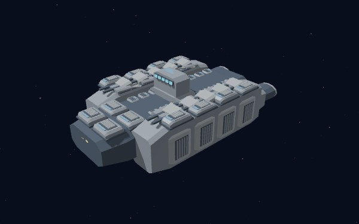
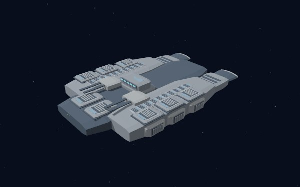
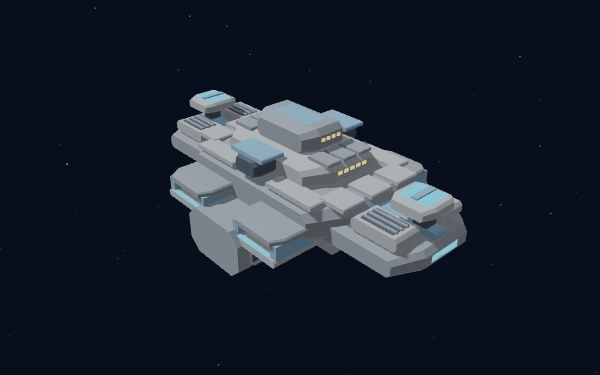
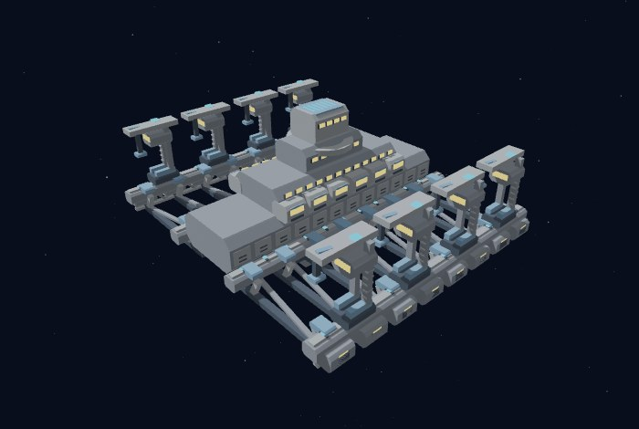

# STAR ARMADA

**STAR ARMADA** is a large-scale, fleet-based real-time strategy game in the spirit of
classic space-fleet RTS titles (Armada II / Fleet Operations era). Build an economy,
colonize worlds, research upgrades and command fleets in an original space-opera universe.
Deterministic **Python gameplay and AI** run alongside a **native C++ bgfx renderer**,
with authored 3D ships and stations and procedural audio.

- **Four factions:** Galactic Imperium, Free Systems Alliance, Automated Legions and Outer Rim Syndicate.
- **Eight skirmish maps** with capacities of **2, 3, 4 or 8 players**; teams or free-for-all.
- **LAN for 2–8 humans**, with optional AI up to **8 total players**, limited by the map.
- Campaign missions, boarding and crew recovery, planetary colonies, station refits and fleet progression.
- **English, German, Polish and Russian**, selectable in Settings.

**[Download for macOS / Windows](https://github.com/ljawor/STAR-ARMADA/releases/latest)**
— **v1.0.0 is being prepared for publication**. Until it is published, this link may
still offer an earlier version; check the version shown on the download page.

### Fleet gallery

Free Systems Alliance ships and stations, captured with the native renderer.
These are isolated model views, not full-match screenshots; each is framed independently.

| Hope-class Command Cruiser · battleship | Liberty Cruiser |
|:---:|:---:|
|  |  |
| **Command Station** | **Shipyard** |
|  |  |

[Image sources and processing](docs/images/v1.0/provenance.json).

## Quick Start

For packaged builds, use the [latest downloads](https://github.com/ljawor/STAR-ARMADA/releases/latest);
Python and a compiler are not required. On macOS, open the DMG and drag the app to
Applications. On Windows, extract the **entire ZIP** and run `STAR ARMADA.exe`.
Check the release notes for signing and first-launch instructions for that download.

**From source:** Python 3.11 is recommended. The native renderer is **required**:
install **CMake 3.25 or newer** and a **C++20 toolchain** (Xcode Command Line Tools on
macOS, Visual Studio Build Tools with Desktop development with C++ on Windows).
The first native build needs an internet connection to fetch its dependencies.
Run the following from the repository root; the build command works on both platforms.

```bash
cd STAR-ARMADA
python3 -m venv .venv           # Python 3.11 recommended
source .venv/bin/activate       # Windows: .venv\Scripts\activate
python -m pip install -r requirements.txt
python -m pip install pyinstaller  # native dependency inspection for the build helper
python tools/build_native_release.py --build-dir render_cpp/build-w02

python main.py                  # title screen → main menu → game
python main.py --skirmish       # straight into a skirmish vs AI (skips menus)
python main.py --smoke          # automated rendered gameplay smoke
python main.py --fullscreen     # start fullscreen
python main.py --load saves/quicksave.json
python main.py --mods example   # load a data override mod
```

## Controls

| Input | Action |
|---|---|
| Left-drag | Box select |
| Left-click | Select unit / station |
| Right-click | Attack target / colonize planet; attack-move on empty ground; selected production stations set a collection point on empty ground |
| Right-drag | Rotate camera |
| Backspace | Stop selected units and cancel pending orders |
| H | Follow selection (legacy alias for Space) |
| Ctrl+1..9 | Assign control group |
| 1..9 | Select control group |
| F | Fleet panel (group selected ships into a fleet, pick commander) |
| B, then left-click | Board a detected shields-down enemy ship/station with an eligible ship; otherwise toggle build menu |
| J, then left-click | Hyperjump selected ships to a destination on the battlefield or minimap; explored and unexplored areas are allowed |
| Esc / right-click during jump selection | Cancel destination selection |
| Space | Follow selection |
| M | Toggle follow / free camera |
| Q / E | Rotate camera |
| WASD / arrows | Pan; manual pan releases follow |
| Mouse-wheel | Zoom (tactical → fighter scale); scroll roster/abilities when hovering their HUD lists |
| Left-click minimap | Recenter the camera and release follow mode |
| X | Tactical overview |
| P | Pause / resume |
| F5 / F9 | Quick save / quick load |
| F10 | Toggle mouse grab |
| ESC | Abort the current operation: ability/jump targeting, placement, fleet panel. Press twice to return to the previous screen |
| F11 | Toggle fullscreen |

## Boarding, crew and life support

Ships and stations carry onboard crew and damageable life support. Failing support
kills crew gradually. Hull damage also causes the loss of **one operating crew member per
10 actual hull damage** after shields and armor; smaller hits accumulate toward the
next casualty. Configure `combat.hull_damage_per_crew` in `game_rules.json` (`0`
disables combat casualties). Passengers and unassigned crew pools are unchanged.
Zero crew leaves an abandoned intact hull with its existing owner. Automatic and
retained attacks stop at abandonment, preserving the hull for recovery/capture;
a new explicit attack on a detected enemy derelict permits destruction.
Already-fired physical projectiles can still hit. AI does not deliberately destroy
derelicts: abandoned planetary satellites cannot be boarded and still block colony
capture, so an AI capture can stall indefinitely until that hardware is removed.
Frigate-and-larger
ships can deploy real boarding craft against detected enemy ships/stations
with all shields down, fight for control and capture them. Select a capable ship,
press **B** or click **Board enemy hull**, then click the target. Successful capture
stabilizes life support to at least **10%**, but does not revive crew. Abandoned hulls have
no defenders and are easier to capture. Repair docks repair owned ships/fighters only;
engineer ships can explicitly repair owned ships, fighters and stations for CR/MT.
Equipment repair does not replace dead crew. See [docs/SUPPORT_ORDERS.md](docs/SUPPORT_ORDERS.md)
for support orders and [docs/BOARDING.md](docs/BOARDING.md) for the
underlying boarding mechanics.

Crew recovery provides automatic owned-hull
recruitment near friendly bases and faction crew transports.
Build/select a transport: **L** loads passengers at a base; **R** / **Deliver crew**
then click an owned hull for field delivery. **Cancel crew order** keeps passengers.
Repair life support to **50%** first. Recruitment/loading consumes unassigned crew and
credits over time; delivery does not charge twice. Cargo is separate from onboard crew,
never powers the ship, and is lost without refund on destruction. Understaffing
proportionally reduces movement, weapons, sensors, repairs, production and research;
life-support effectiveness is not staffing-scaled. Cautious AI uses the same commands.
No towing, allied reclaim or neutral salvage. Initial defaults and limitations:
[docs/CREW_RECOVERY.md](docs/CREW_RECOVERY.md).

## Planetary hardware / HUD

The interface provides independently minimizable left/right/mission panels,
3D satellite orbits that pause for engagement, lower satellite cost/durability, and
six separate planetary surface slots for resource, trade, surface-only shield and
long-range pulsar buildings. Basic colony income remains unchanged.
See [PLANETARY_HARDWARE.md](docs/PLANETARY_HARDWARE.md)
for mechanics and configurable tuning.

## Infrastructure command points

All living stations, surface buildings and satellites consume **1 CMD**, except
research stations (**5 CMD**). Every owned eligible colony adds a command center's
capacity (**20** by default, mod-aware). Paid construction reserves CMD before
resources are charged; the HUD's used total includes reservations and its build rows
show their CMD costs. Abandoned hulls still count, while destruction/cancellation
releases usage. Losing capacity blocks new purchases, not already paid production.
See [the accounting and lifecycle contract](docs/COMMAND_CAPACITY.md).

### Cancelling paid work and cost-based building times

Paid construction is now cancellable. A selected station's build-queue rows and a
colony's paid slot cells carry a **✕ Cancel** affordance that submits a
`cancel_build` command; it stops one queued item and refunds **half** of that
item's catalogue cost (the other half pays for work already done). The freed
command points — and, for a colony, the freed surface slot or orbit — return
immediately, because usage and reservations are derived from the live queues.
Colonisation is a standing fleet order with no resource cost, not paid
construction, so it is not cancellable this way; re-order the ship instead. A
cancel is never treated as a new order, so it cannot supersede the units' other
standing orders. Surface building time follows the resource bill:
seconds are the building's credits + materials + energy over
`planet_buildings.resource_units_per_second` (80 units/s shipped), so the
extractor and trade hub take 20 s, the shield generator 27.5 s and the pulsar
cannon 35 s instead of every type sharing one flat 24 s. The catalogue
`build_time` must mirror the derived value — the data store rejects a catalogue
that disagrees, which keeps the time the HUD prints equal to the one the
simulation runs. See [docs/COMMAND_CAPACITY.md](docs/COMMAND_CAPACITY.md) and
[docs/PLANETARY_HARDWARE.md](docs/PLANETARY_HARDWARE.md).

## Planetary colonies and satellites

Colony ships are available to all four built-in factions: command-center-only
production, non-gas planetary settlement,
crew/resource income and timed enemy-colony capture after all defending satellites
are destroyed. Successful control consumes the colony ship without an extra fee.
Owned planets expose paid defense/attack satellite construction with a shared limit.
Support includes paid engineer repairs,
ship/fighter-only repair docks, universal build crew-cost labels and automatic fighter
exploration that avoids detected enemies. Trade stations require 1,500-unit spacing;
new stations/satellites require 3,000-unit clearance from enemy command centers.
See [docs/SUPPORT_ORDERS.md](docs/SUPPORT_ORDERS.md) and
[docs/COLONIES.md](docs/COLONIES.md) for rules and tuning.

Colonized planets provide **5× the base resource and crew income**.
See [gameplay notes](docs/GAMEPLAY_ACCEPTANCE.md) for balance context.

## Combat experience and ship ranks

Ships and fighter squadrons begin at **rank 1**. Fighting earns XP from actual
shield and hull damage dealt to enemies (overkill is excluded), plus a kill
reward based on the destroyed unit's maximum hull. Own/allied units, neutral
terrain, dead attackers and station attackers cannot provide ship XP.
Already-fired projectiles still inflict damage after their shooter dies, but
cannot award that dead ship XP.

Every catalogue ship/squadron declares `max_rank` (currently **5**). Promotions
add **5% weapon damage** and **5 percentage points of incoming damage reduction**
per rank: rank 5 has +20% attack and 20% damage reduction. Reduction applies to
both shields and hull, not just shield capacity. Existing veteran utility/shield
bonuses remain, but there is no second veteran weapon-damage multiplier.

Balance lives in `assets/data/game_rules.json`: `experience.levels` defines
cumulative thresholds, scaled by each ship's `veteran_xp / 100`;
`experience.max_effective_level` is the global cap, and
`experience.per_level.attack_bonus` / `defense_bonus` configure promotions.
The effective cap is the minimum of the ship cap, global cap, available
thresholds and safety cap 5. XP can continue accumulating at the cap. DataStore
validates caps, thresholds and bonuses after mod overrides; older ship
definitions without `max_rank` default to 5, and old saves derive rank from XP.
Full-precision saves/replays preserve XP and projectile shooter identity.

## Fleet selection and tactical presentation

Selecting several ships shows a scrollable/paged roster rather than only one
representative ship. The HUD combines the selected owned units' special abilities,
with readiness, cooldown and energy feedback; commands apply only to eligible
owned recipients. Jump destination selection and targeted abilities are mutually
exclusive and can be canceled. Construction orders and progress are laid out
separately, including on smaller windows.

Ship sizes are normalized from rendered hull geometry: the largest hull is
**5× a corvette**, with a shared tactical readability scale. Metal hulls,
procedural planets/deep space, directional shield impacts, hull-hit effects and
per-weapon procedural audio distinguish fleets and combat. Close zoom now avoids
visible base geometry without changing requested zoom limits; ships behind the
camera no longer inflate into giant mesh planes. Picking, effects and audio use
the same effective camera view, and camera obstacle filtering avoids unnecessary
distant hidden-fleet visibility scans.

## Faction ships and stations

Faction identity now comes from **3D geometry**, independently of player color:

| Faction | Ships | Stations |
|---|---|---|
| **Galactic Imperium** | Armored wedge hulls and tapered escorts | Angular command hubs and industrial docks |
| **Free Systems Alliance** | Segmented armored hulls and twin engine blocks | Layered command decks and open gantry docks |
| **Automated Legions** | Forked bows and repeated robotic machinery | Threefold hubs and modular machine docks |
| **Outer Rim Syndicate** | Asymmetric armored barges and offset bridges | Salvaged modules, unequal docks and cranes |

Authored ship, station and convoy models give each faction a distinct silhouette.
Construction previews and sites match the faction hardware; camera bounds, shields
and hull-hit contacts follow the rendered geometry, including open docking/fork gaps.
Faction appearance is separate from gameplay balance and catalogue availability.
See [the faction hardware notes](docs/FACTION_VISUALS.md) for more detail.

Ownership remains a separate visual channel: colored hull accents and screen-clamped
markers distinguish players and hostiles. Settings allow markers on all units,
hostiles only, or off; markers obey current sensor visibility.

## Menus

`main.py` now starts at the **title screen** → **main menu** (Skirmish / Campaign /
Multiplayer / Settings / Quit). Settings (music/SFX volume, fullscreen, autosave,
camera pan speed) persist to `saves/settings.json` in source runs. Packaged builds
store settings, saves and campaign progress outside the application bundle:
`~/Library/Application Support/STAR ARMADA` on macOS and `%APPDATA%\STAR ARMADA`
on Windows. The **Campaign** screen pages an introductory
recovery drill plus the original ten-mission "Rise of the Outer Armada" chain (`assets/data/campaign/campaign.json`); each mission
has a briefing (story, objectives, enemy preview) before LAUNCH, and in-game objectives
are tracked live in the HUD with COMPLETE/FAILED states. A finished mission is marked
COMPLETE in gold on the campaign screen and stays selectable for replay, and
acknowledging a campaign result returns to that campaign screen rather than the main menu.

Recovery Drill's objective is to capture the abandoned syndicate
corvette and restore **that captured corvette to 100% onboard crew**. Automatic
recruitment near a friendly base and loaded crew-transport delivery both count; a
full surviving boarding party can complete it immediately. The abandoned frigate
is optional practice, not a delivery requirement. Personnel costs, life-support
safety and campaign unlock-save migration are unchanged. See [campaign scripting](docs/CAMPAIGN_SCRIPTING.md) for mission rules.

### Audio, cinematics, help and accessibility

Presentation options include:

- **Audio:** standard/night dynamic-range profiles, mono output, live music/SFX gain
  controls and reserved ambient/critical/objective channels. Own notifications are
  independent of camera distance; spatial enemy combat cues still require detection.
- **Campaign:** short in-engine intros and success/failure outros. Enter, Space,
  Escape or mouse click skips; camera and simulation time are restored without
  catch-up. Cinematics can be disabled and never run in LAN or replay playback.
- **Help:** F1 opens paged controls/support help; Escape/F1 closes. It consumes gameplay
  input, clears held gestures/targeting, and does not independently pause LAN.
- **Targeted accessibility:** high-contrast help/hint panels, optional recovery-drill
  hints placed around existing HUD controls, and reduced cinematic pan/fades.
  This is not whole-game scaling, screen-reader support or removal of all combat effects.
- **Settings:** keyboard/mouse-reachable pages; all new options persist and reject
  malformed/nonfinite values.

See [presentation notes](docs/PHASE10_ACCEPTANCE.md) for details and limitations.

## Localization — English, German, Polish, Russian

The source ships four languages: English, Deutsch, Polski and Русский. `Settings → Language`
cycles them and applies immediately; the choice persists in `saves/settings.json`, for
example as `"language": "ru"`.

A language is **presentation only**: packs are read at the drawing edges (the classic
canvas, the menu helpers, `HUD._label` and the word-wrap helper), a pack that is missing a
line falls back to English, and no module under `game/` can even import the layer — so two
lockstep peers may play the same match in different languages and still agree on every
ticksum. Assembled text (a victory banner, a refit level line, a resource bill) is asked
for as a template, e.g. `t('{credits} cr · {materials} mt')`, and every data-driven name
(ships, stations, factions, tech, weapons) is translated too:

| | English | Deutsch | Polski |
|---|---|---|---|
| Station panel | `REFIT · LEVEL 3/5` | `UMBAU · STUFE 3/5` | `PRZEBUDOWA · POZIOM 3/5` |
| Main menu | `Settings` | `Einstellungen` | `Ustawienia` |
| A hull | `Shipyard` | `Werft` | `Stocznia` |

Packs live in `assets/data/lang/`; `tools/lang_coverage.py` extracts the catalogue from the
source and reports coverage for every registered pack,
and `tools/build_lang_packs.py` refuses to write a pack that is missing a key or carrying a
dead one. See `docs/LOCALIZATION.md` and run `python tools/diag_i18n.py` to re-check that
geometry, truncation and lookup coverage all hold.

## Weapon audio — laser and photon voices

Every sound is synthesised by `render/audio.py` at load time; **no audio file ships with the
game**. Laser and photon reference recordings informed the synthesised voices:

| Voice | Character |
|---|---|
| Laser family | 300 ms dark thump, centroid ~1.4 kHz, 137 ms tail |
| Point-defense | Smaller, brighter gun voice, over in 90 ms |
| Turbolaser (+ heavy) | 500/680 ms broadband thump, rolloff ~7.3 kHz |
| Plasma lance | Photon character, top end closing downward |

The references are a **target, not an asset**: they are not in the repo, and were measured
with `tools/sfx_character.py`, which measures a recording and a synthesised voice with the
same function (weight = spectral centroid, crack = 95 % magnitude rolloff, tail). Their
numbers live in that module's `REFERENCE_TARGETS`; `tools/diag_weapon_sfx.py` re-checks every
voice against the band they define and exports each as a WAV and a spectrogram, and
`tests/test_weapon_sfx.py` pins bands, voice relationships and "no two weapons measure as the
same shot". One deviation is deliberate: the recordings swell to their peak over 70–150 ms,
a game voice is punched in ~3 ms, because fire feedback cannot wait. See
`docs/WEAPON_AUDIO.md`.

## Skirmish maps and setup contract

The built-in skirmish catalogue is restricted to these eight map IDs. Capacity is
**total players**, including the human; selecting fewer opponents uses the chosen
spawn slots and leaves the remaining terrain/resources in place.

| Map ID | Public name | Capacity | Layout |
|---|---|---:|---|
| `skirmish01` | Sector Duel — Kotarri Sector | 2 | Original duel; legacy geometry, starts and loadout preserved |
| `skirmish02` | Trinary Reach | 3 | Equilateral triangle, personal expansion pockets, contested central mine |
| `skirmish03` | Crossroads | 4 | Open corner quadrants with broad flanking lanes and four inner reserves |
| `skirmish04` | Nebula Frontier | 4 | Cardinal starts, diagonal gas-giant barriers and sensor-reducing nebula banks |
| `skirmish05` | Eightfold Crown | 8 | Rim bastions around a central gas giant, inner reserves and outer flanking routes |
| `skirmish06` | Titan Divide | 2 | Opposing bases, a central gravity well and two polar passages |
| `skirmish07` | Offset Corridors | 2 | Diagonal starts, twin gas giants and a contested central mining lane |
| `skirmish08` | Amber Spiral | 3 | Clockwise expansion arms, a central research world and nebula-covered reserves |

New maps give each slot the same nearest mining-field distance and an equally
accessible temperate colony, with room for station construction. Kotarri retains
its existing asymmetric colony types and distances rather than changing campaign
or integration-fixture gameplay. Nebulae reduce sensors; they are not solid walls.
Each JSON exposes `name`, `description`, `max_players`, `bounds`, player `start`
positions and neutral geometry (`asteroid_fields`, `gas_giants`, `planets`,
`nebulas`, `jump_points`) for a public terrain preview, not live enemy intelligence.

Setup requirements/contract:

- One human in slot 0 plus **1–7 AI players**, limited to map capacity minus one.
  Choose **Team 1–8** for each player: matching teams are allies; different teams
  are enemies. At least two active teams are required to launch.
- Allied ships and stations are always visible, including allied AI fleets outside
  your own sensors. Allies share sensor coverage and exploration, but not control
  of each other's units. Unseen enemies remain hidden.
- Allies cannot attack each other. Trade routes connect only distinct **own or
  allied trading stations**, never enemy stations. Convoys cannot deliver back
  to their source market. Restored legacy convoys without recorded source-market
  identity remain idle and generate no delivery income; build new routes instead.
- Skirmish and LAN victory requires eliminating **every enemy ship, squadron and
  station**. Destroying only the enemy command station is insufficient. Victory
  belongs to the surviving team, including an ally whose own forces were eliminated.
  Campaign objectives retain their mission-specific rules.
- Active players must have distinct colors from **blue, red, green, purple,
  orange, cyan, yellow, pink**. Color identifies the player independently of faction.
- Difficulty is **easy**, **normal** (default), or **hard**, applied to AI players.
- Faction choices use registered data IDs: `imperial` (Galactic Imperium), `rebel`
  (Free Systems Alliance), `confederacy` (Automated Legions), and `syndicate`
  (Outer Rim Syndicate). Syndicate remains marked non-playable in the faction data;
  its prototype skirmish support should not be mistaken for full faction parity.
  Faction data determines starting resources and available engineering/combat hulls.
- Default map slots are all Imperial, with one command station, one shipyard, one
  constructor, two squadrons and two corvettes per slot. The JSON loadout uses
  generic ship roles, resolved to faction-specific hulls when the game starts.
- The setup payload has `map_id`, integer `ai_count`, four-to-eight-slot `colors` and
  `factions` lists, `ai_difficulty`, and an optional four-to-eight-slot integer `teams` list
  (values 0–7), plus optional `spawn_slots` selecting distinct map starts. Omitting teams retains free-for-all defaults; inactive choices do
  not participate. Setup conversion must not mutate the shared DataStore map definition.

Focused map acceptance checks (real headless GameManager starts, actual starter
footprints/gravity clearance, resource access, legal AI sites and short deterministic
AI runs; not a substitute for full-match or rendered-menu playtesting):

```bash
PYTHONPATH=tests .venv/bin/python -m unittest test_skirmish_maps -v
```

## LAN multiplayer

Open **Multiplayer** to host or join by LAN IPv4 address. The host selects a
**TCP port** (default **7777**) and uses the same eight maps as Skirmish, with
**2–8 human players** and optional AI, up to **8 total players** within map capacity. Cooperative play puts
humans on a shared team against AI; free-for-all uses separate teams.

For setup, Windows Firewall commands, and troubleshooting, see **docs/LAN.md**.
Firewall rules are not changed automatically. All computers must use the same game
version and simulation content. LAN matches disable independent pause and save/load.

## Gameplay loop

```
BUILD mining stations → GATHER credits/materials/energy → RESEARCH upgrades
→ BUILD fleet (fighters → corvettes → frigates → cruiser → battleship)
→ FORM fleets with commanders → FIGHT and earn ranks
→ ELIMINATE all enemy ships, squadrons and stations → TEAM VICTORY
```

## Sensors and fog of war

Space has three visibility states: **unexplored**, **explored but outside sensor coverage**,
and **currently detected**. Exploring a region charts its fixed map features; it does
not grant permanent tracking of enemy fleets. Enemy ships and stations require current
friendly sensor coverage to appear on the battlefield or minimap and to be targeted.

Every ship and station uses its own data-defined `sensor_range`. Friendly teammates
share detection. Sensor stations extend the network significantly: their base range is
5,200 units, compared with 3,000 for command stations and 1,000–2,000 for most other
stations. Ship ranges vary by class and faction. Sensor damage, jamming, nebulae,
research and recon commanders modify effective range.

Losing detection breaks the target lock: weapons cannot fire new shots or keep chasing
an unseen target's live position. Already-fired ballistic shots continue travelling;
guided projectiles cannot keep tracking a target outside sensor coverage. A remote
friendly sensor can provide detection for another ship's longer-range weapons.

## Repository layout

```
main.py                  entry point
game/                    simulation core (no rendering imports)
  core/                  vectors, entity, events, commands, state, manager, ids
  data/                  loaders + dataclasses mirroring the JSON schema
  systems/               simulation systems (movement, combat, economy, ...)
  ai/                    strategic & tactical AI
  net/                   LAN lobby, transports, lockstep and replay
render/                  native bridge, camera, UI, minimap, menus, audio, input
render_cpp/              native C++ bgfx renderer
visual_packs/            authored faction models and visual-pack manifests
assets/data/             JSON: factions, ships, weapons, tech, maps, abilities, campaign
assets/audio/            (generated at runtime — no binary assets committed)
tests/                   headless simulation tests
docs/                    design + architecture notes
```

## Testing

```bash
PYTHONPATH=tests .venv/bin/python -m unittest discover -s tests -v
```

Tests run the **real simulation headless** — no window, no GPU — covering economy,
combat, subsystem damage, formations, squadrons, research, AI, save/load, victory
conditions, trade convoys, mission objectives and the full
build→gather→research→fleet→attack→win loop.
Renderer diagnostics and native integration checks are separate from headless tests;
rendered checks need a working graphics environment. See [packaging](docs/PACKAGING.md)
and [gameplay notes](docs/GAMEPLAY_ACCEPTANCE.md) for additional workflows and limitations.

## License / originality

All code and data in this repository are original. Ship/faction names are data; swap
`assets/data/*.json` for your own universe. Mechanics are inspired by the classic
fleet-RTS genre; no third-party code or assets are included.
