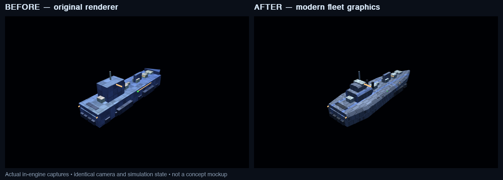
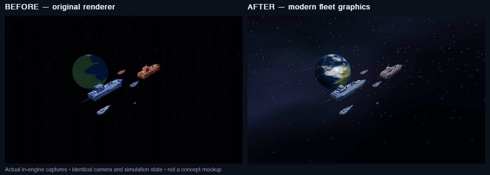
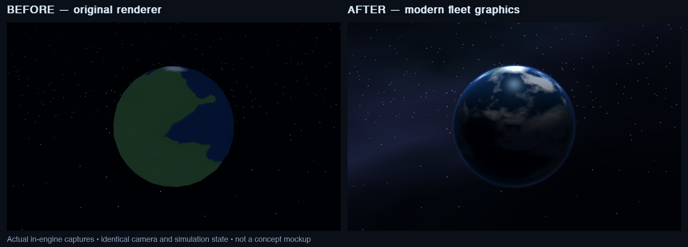

# Modern fleet graphics

An in-engine graphics pass on the existing compatibility OpenGL renderer. These
are **real before/after captures**, not concept art. The diagnostic uses the same
camera, frozen animation clock and simulation checksum on both sides.





## Changes

- GLSL 1.20 ship materials: neutral metal, faction-painted bands, resolvable plate
  seams and vents, per-fragment highlights, roughness variation and edge lighting.
- Beveled, tapered cruiser/battleship hulls and stepped command towers instead of
  rectangular primary hulls. Existing weapons and detail passes remain.
- Higher-resolution planets with coasts, terrain variation, cloud fronts,
  day/night lighting, ocean highlights and thin atmospheric rims.
- Dim eye-centered deep-space panorama, separate from crisp stars and gameplay
  nebulae. It does not write depth or obscure foreground objects.
- Planet surface generation/upload is cached by stable identity instead of
  regenerating a surface every frame. Stable seeds replace process-random hashes.
- Idle HUD help cards and short event logs occupy only the space they need;
  selected constructors retain the full inspector and build buttons.
- HUD colours no longer inherit the last world surface's lighting/normal.
- Renderer/HUD GL resources are explicitly released on game restart and exit;
  failed shader compilation/linking releases its partial allocations before fallback.

The simulation, resource rules, weapons and multiplayer tick logic are unchanged.
This is not a PBR/HDR engine replacement: stations, combat VFX and shields retain
the existing fixed-function passes. Bespoke authored ship assets and shadow maps
are outside this pass.

## Compatibility and fallback

Verified on Apple M4, OpenGL `2.1 Metal - 90.5`, GLSL `1.20`, with a real window.
Shader compilation failure logs a warning and falls back to fixed lighting.
To explicitly exercise that fallback:

```sh
STAR_ARMADA_FIXED_MATERIALS=1 .venv/bin/python main.py --skirmish
```

The new geometry, sky and planet textures remain in fallback mode; shader-only
highlights and atmospheric shells do not. No new package dependencies.
Windows runtime/driver verification is still required before claiming parity.

## Reproduce

Run from the repository with a real window server (not SDL dummy video):

```sh
PYTHONPATH=.:tests .venv/bin/python -m unittest discover tests -p 'test_*.py'
PYTHONPATH=.:tests .venv/bin/python tools/diag_modern_fleet.py \
  --label after --out /tmp/star-armada-graphics --require-modern
PYTHONPATH=.:tests .venv/bin/python tools/diag_hud_compact.py /tmp/star-armada-graphics
PYTHONPATH=. .venv/bin/python tools/diag_gl_lifecycle.py
.venv/bin/python main.py --smoke
```

For a baseline comparison, first capture the unchanged baseline with the same
`diag_modern_fleet.py` script and `--label before`. Then capture the changed
renderer with `--compare /path/to/before_metrics.json`. Do not regenerate the
baseline from the changed source. The comparison rejects changed scene checksums,
non-repeatable frozen frames, simulation mutation and GL errors.

Supplemental existing diagnostics: `diag_gfx2.py`, `diag_gfx5.py`,
`diag_detail.py`, `diag_trade_readout.py`, `diag_research_progress.py`.

## Measurements

One synchronized, warmed M4 run at 1280×800 (median milliseconds per frame):

| Ships | Before | After |
|---|---:|---:|
| 20 | 1.84 | 1.93 |
| 60 | 3.24 | 3.60 |
| 150 | 7.36 | 8.27 |

These are **render-only** samples with background, shields, HUD and simulation
excluded, not gameplay FPS or a broad hardware performance claim. Small samples
and GPU scheduling have noise; the additional hull cost should be assessed again
on target Windows hardware.

Verification on this Mac: **165 unit tests passed**, `SMOKE_OK` / `SMOKE_DONE`
after 30 simulated seconds, normal and forced-fallback graphics diagnostics,
shield/detail/movement visual regression probes, and three GL resource
create/draw/release cycles. The real shader compiler failure probe also confirmed
fallback and cleanup. The suite retains two pre-existing unclosed-file warnings.

The HUD diagnostic checks actual GL pixels against the alpha composite of its
pygame surface and the world frame. The pre-fix colour error was 127/255; the
corrected maximum is 0.5/255 (rounding). At 1280×800 with no selection and one
logged event, compact panels reclaim 269,120 pixels, or 26.28% of screen area.
